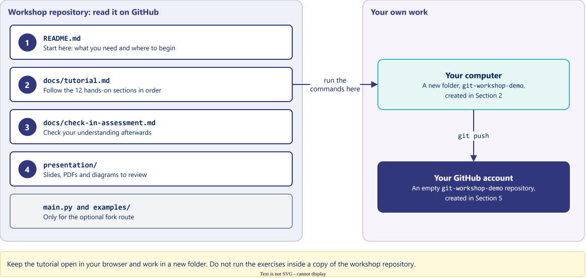

# Introduction to Git Workshop

A hands-on introduction to Git and GitHub for beginners. You build a small repository from scratch, push it to GitHub and open a pull request in your own repository. The workshop is for RDP staff and client staff, and no earlier Git experience is needed.

## Format

| Format | Length | Slides | Materials |
| --- | --- | --- | --- |
| Full workshop: hands-on | 2 to 3 hours | 59 | [Tutorial](docs/tutorial.md), [deck (PPTX)](presentation/introduction-to-git-workshop.pptx) and [deck (PDF)](presentation/introduction-to-git-workshop.pdf) |

## How to use these materials

This repository holds the learning materials for the workshop. Read them on GitHub, or download them if you would rather work offline.

Work through the materials in this order:

1. This `README.md`, for the format, the prerequisites and the links.
2. [docs/tutorial.md](docs/tutorial.md), the 12 hands-on sections, in order. Keep it open in your browser next to your terminal. Type each command yourself, then compare what you see with the Expected Output. Copy only fiddly items such as URLs and email addresses. Use the Troubleshooting table at the end when you get stuck.
3. [docs/check-in-assessment.md](docs/check-in-assessment.md), to check your understanding once you finish the exercises.
4. The [presentation](presentation/) folder, for the slides, the deck PDF and the diagrams to review. The [presenter guide](presentation/presenter-guide.md) is for whoever runs the session.

**Do the exercises in a folder of your own.** Section 2 has you create a new folder called `git-workshop-demo`, and Section 5 has you create an empty GitHub repository of your own. Do not run the main-route exercises inside a clone of this workshop repository. The only time you clone the workshop repository is for the optional fork appendix, which uses `main.py` and `examples/main_updated.py`.

## What You'll Learn

- Configure Git on your computer
- Create a repository, stage files and make commits
- Write commit messages that follow the Conventional Commits standard
- Sign in to GitHub and push your work
- Create and push a branch
- Open, review and merge a pull request
- Clean up branches afterwards

## Prerequisites

- Git 2.28 or newer (install the latest from [git-scm.com](https://git-scm.com))
- A [GitHub](https://github.com) account
- A text editor
- Python 3. Check with `python --version`. macOS and Linux may need `python3`. Windows may use `py`.
- On Windows, use PowerShell or Git Bash.

## Workshop Sections

1. Set Up Git Configuration
2. Initialize a New Git Repository
3. Create and Stage Files
4. Make Your First Commit
5. Create a GitHub Repository and Sign In
6. Link Your Repository to GitHub and Push
7. Create and Switch to a New Branch
8. Modify Files and Commit on the Branch
9. Push the Branch to GitHub
10. Create a Pull Request
11. Review and Merge the Pull Request
12. Clean Up and Pull the Latest Changes

Start with the [tutorial](docs/tutorial.md). When you finish, try the [check-in assessment](docs/check-in-assessment.md).

## Optional: Fork Route

The tutorial has an appendix on contributing through a fork of this repository. It covers cloning a fork, adding an `upstream` remote and opening a pull request against your own fork. The main route does not need it.

## Repository Contents

| Path | Description |
| --- | --- |
| `README.md` | This file |
| `main.py` | Starting file for the optional fork route |
| `docs/tutorial.md` | Step-by-step tutorial |
| `docs/check-in-assessment.md` | Whiteboard questions to check your understanding |
| `examples/main_updated.py` | Finished calculator for the fork route |
| `presentation/introduction-to-git-workshop.pptx` and `.pdf` | Slides for the full workshop |
| `presentation/presenter-guide.md` | Notes for the presenter |
| `presentation/quiz-questions.md` | Rewind questions, answers and Mentimeter setup |
| `presentation/diagrams/` | Editable [draw.io](https://www.drawio.com) diagrams. The `.drawio.svg` files open in draw.io. |

## Further Learning

- [Pro Git book](https://git-scm.com/book)
- [GitHub Docs](https://docs.github.com)

## Licence

This workshop content is available for educational use. Feel free to adapt and share for learning purposes.
