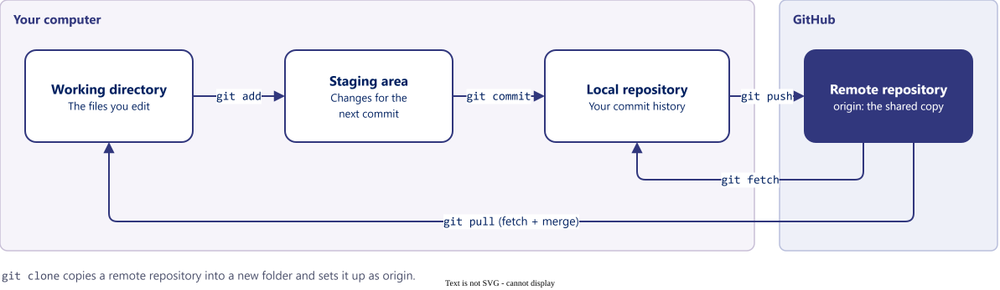
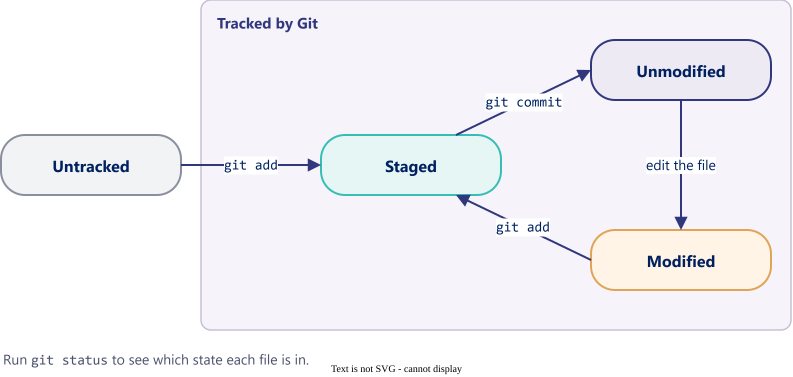
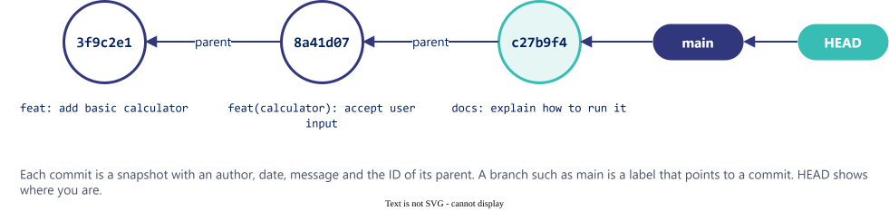
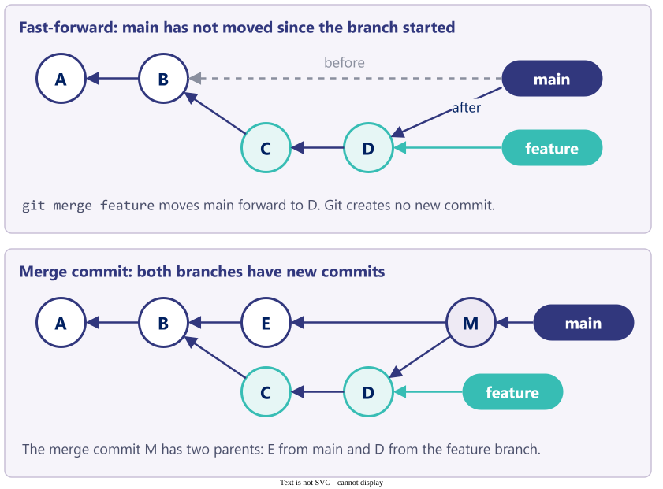
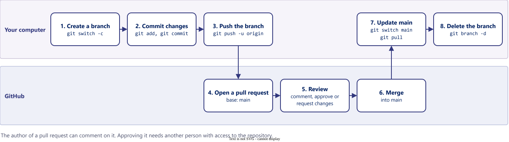
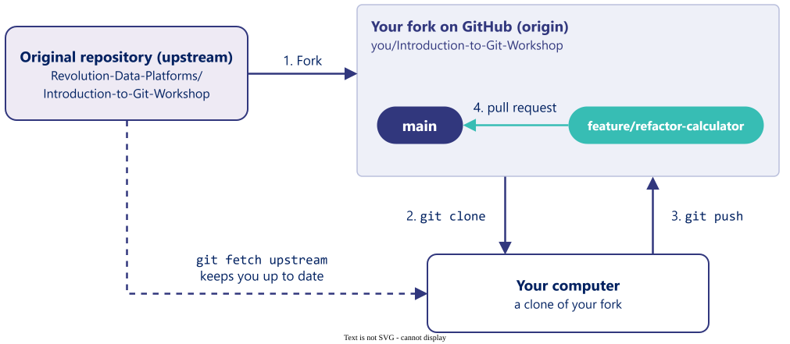

# Introduction to Git Workshop: Tutorial

This tutorial teaches the basics of Git through hands-on command line exercises. You will build your own repository from scratch, push it to GitHub, and open a pull request in your own repository.

## What You'll Learn

By the end of this workshop, you will be able to:

- Configure Git on your computer
- Create a repository, stage files and make commits
- Sign in to GitHub and push your work
- Create a branch and make changes on it
- Open, review and merge a pull request
- Clean up branches afterwards

## Prerequisites

- Git 2.28 or newer. Check with `git --version`. Install the latest version from [git-scm.com](https://git-scm.com).
- A [GitHub](https://github.com) account
- A text editor (VS Code, Notepad++, nano, vim or similar)
- Python 3. Check with `python --version`. On macOS and Linux you may need `python3 --version`. On Windows you may need `py --version`.
- Basic comfort with a command line

Windows users can run every command in this tutorial in **PowerShell** or in **Git Bash**, which is installed with Git for Windows. Commands that differ between shells show both versions.

If you use `python3` or `py` on your computer, substitute it wherever the tutorial says `python`.

## Section 1: Set Up Git Configuration (1 of 12)

Git attaches a name and email address to every commit. Set them once per computer.

### Commands to Run

```bash
# Your name and email (replace with your own)
git config --global user.name "Your Name"
git config --global user.email "your.email@example.com"

# Make new repositories start on a branch called main
git config --global init.defaultBranch main

# Verify
git config --global --list
```

The `init.defaultBranch` setting needs Git 2.28 or newer. Without it, many installs, including Git for Windows, still create a branch called `master`.

Optional: if you do not want your personal email in public commits, use your GitHub noreply address. You can find it in GitHub under Settings > Emails.

### Expected Output

`git config --global --list` shows `user.name`, `user.email` and `init.defaultBranch=main`. It may show other settings too.

### Key Concepts

- Global settings are stored on your computer and apply to all your repositories.
- Your name and email appear in every commit you make.
- You only need to do this once per computer.

## Section 2: Initialize a New Git Repository (2 of 12)

You will create a new folder and turn it into a Git repository.

### Commands to Run

```bash
mkdir git-workshop-demo
cd git-workshop-demo
git init

# Show hidden files, including .git
ls -la
```

In PowerShell, use `Get-ChildItem -Force` instead of `ls -la`.

### Expected Output

Git reports that it initialized an empty repository. The folder listing includes a `.git` folder.

### Key Concepts

- The hidden `.git` folder holds the whole history and settings of the repository.
- Delete `.git` and the folder is an ordinary folder again, with its history gone.

## Section 3: Create and Stage Files (3 of 12)

Git tracks files through three areas: the working directory, the staging area and the repository.



### Create the File

Create `main.py` in the `git-workshop-demo` folder with your editor (for example `code main.py` or `nano main.py`) and add exactly this:

```python
# Simple Calculator
x = 1
y = 2

print(f"The sum of x and y is: {x + y}")
```

### Commands to Run

```bash
# main.py is new, so Git lists it as untracked
git status

# Stage the file
git add main.py

# main.py is now staged
git status
```

### Expected Output

- First `git status`: `main.py` appears under "Untracked files".
- Second `git status`: `main.py` appears under "Changes to be committed" as a new file. Your terminal may use colours to mark these, and the colours depend on your settings.
- On Windows, `git add` may print "warning: in the working copy of 'main.py', LF will be replaced by CRLF the next time Git touches it". This is harmless.

A file moves through four states: untracked, unmodified, modified and staged.



### Key Concepts

- The staging area lets you choose exactly what goes into the next commit.
- `git add .` stages every change in the current folder. Check `git status` first so you know what that includes.

## Section 4: Make Your First Commit (4 of 12)

A commit is a snapshot of your staged changes, with a message, an author and a date.

### Commands to Run

```bash
git commit -m "Add basic calculator"

# One line per commit
git log --oneline

# Full details
git log

git status
```

### Expected Output

- The commit output says one file changed.
- `git log` shows your commit with its author, date and message.
- `git status` says "nothing to commit, working tree clean".



### Key Concepts

- Every commit has a 40-character ID (a hash). `git log --oneline` shows a shortened version.
- Each commit points to the commit before it, which forms the history.

### Writing Commit Messages

Write the first line in the imperative mood, as if finishing the sentence "This commit will ...". Write "Add feature", not "Added feature" or "Adds feature". Keep the first line to 50 characters or fewer. If you need more detail, leave a blank line and then add the details.

## Section 5: Create a GitHub Repository and Sign In (5 of 12)

### Create an Empty Repository on GitHub

1. Sign in to github.com and select **New repository**.
2. Name it `git-workshop-demo`.
3. Do not add a README, `.gitignore` or licence. An empty repository means your first push has nothing to clash with.
4. Select **Create repository**.
5. Copy the repository URL. The HTTPS form is `https://github.com/you/git-workshop-demo.git`.

You will link your local repository to it in Section 6. Before that, choose one way to sign in.

### Recommended: HTTPS with Git Credential Manager

Git for Windows includes Git Credential Manager and configures it for you (`credential.helper=manager`). On your first push, a browser window asks you to sign in to GitHub. You do not need a token.

On macOS and Linux, do one of these:

- Install [Git Credential Manager](https://github.com/git-ecosystem/git-credential-manager)
- Sign in with GitHub CLI: `gh auth login`
- Use a personal access token (next section)

### Fallback: Personal Access Token

GitHub stopped accepting account passwords for Git operations on 13 August 2021. If you are asked for a password, paste a token instead.

When you push, Git asks for a username and a password. Enter your GitHub username, then paste the token as the password. Nothing appears on screen as you paste.

Create a fine-grained token limited to your workshop repository:

1. In GitHub, open **Settings > Developer settings > Personal access tokens > Fine-grained tokens**.
2. Select **Generate new token**.
3. Enter a name and an expiration date. A short expiry is fine for a workshop.
4. Under **Repository access**, select **Only select repositories** and choose `git-workshop-demo`.
5. Under **Repository permissions**, set **Contents** to **Read and write**.
6. Select **Generate token** and copy it straight away. GitHub does not show it again.

Classic tokens with the `repo` scope also still work, but they cover all your repositories, so prefer a fine-grained token.

### Alternative: SSH Key

```bash
# Generate a key (press Enter to accept the default location)
ssh-keygen -t ed25519 -C "your.email@example.com"

# Git Bash: start the agent and add the key
eval "$(ssh-agent -s)"
ssh-add ~/.ssh/id_ed25519

# Copy the public key
cat ~/.ssh/id_ed25519.pub
# Git Bash: clip < ~/.ssh/id_ed25519.pub
# macOS:    pbcopy < ~/.ssh/id_ed25519.pub
```

Windows PowerShell does not use `eval`. It uses the OpenSSH Authentication Agent service to hold keys.

```powershell
# Start the agent. An administrator may need to set it to start automatically:
# Get-Service ssh-agent | Set-Service -StartupType Automatic
Start-Service ssh-agent
ssh-add $env:USERPROFILE\.ssh\id_ed25519

# Copy the public key to the clipboard
Get-Content $env:USERPROFILE\.ssh\id_ed25519.pub | Set-Clipboard
```

Then in GitHub, open **Settings > SSH and GPG keys > New SSH key**, paste the public key and save. Test the connection:

```bash
ssh -T git@github.com
```

You should see a message that starts with "Hi your-username! You've successfully authenticated". If port 22 is blocked on your network, GitHub supports SSH over port 443 using `ssh.github.com`. See [Using SSH over the HTTPS port](https://docs.github.com/en/authentication/troubleshooting-ssh/using-ssh-over-the-https-port).

If you use SSH, the repository URL is `git@github.com:you/git-workshop-demo.git`. You will use it in Section 6.

### Quick Comparison

| Aspect | Git Credential Manager (HTTPS) | Personal access token (HTTPS) | SSH key |
| --- | --- | --- | --- |
| Setup | Included with Git for Windows | Create a token in GitHub | Generate a key and add it to GitHub |
| Sign-in | Browser, first push only | Paste the token as the password | None after setup |
| Expiry | Managed for you | Tokens expire | Keys do not expire |
| Networks | Works through most firewalls | Works through most firewalls | Port 22 may be blocked |
| Best for | Windows beginners | macOS and Linux without Credential Manager | Daily use |

Use one SSH key per computer. Do not copy private keys between machines. Add each machine's public key to GitHub instead.

## Section 6: Link Your Repository to GitHub and Push (6 of 12)

You already have a local repository with a commit. You will link it to the empty GitHub repository and push.

### Commands to Run

```bash
# Link (replace with your own URL: HTTPS or SSH)
git remote add origin https://github.com/you/git-workshop-demo.git

# Make sure the branch is called main (safe if it already is)
git branch -M main

# Push and set main to track origin/main
git push -u origin main

# Verify
git remote -v
git branch -vv
```

### Expected Output

- The push prints progress and ends with a line such as `branch 'main' set up to track 'origin/main'`.
- If you use a personal access token, Git asks for a username and a password. Enter your GitHub username, then paste the token as the password. Nothing appears on screen as you paste.
- `git remote -v` lists `origin` for fetch and push.
- `git branch -vv` shows `main` tracking `origin/main`.
- Refresh your GitHub repository page. `main.py` and your commit are there.

### Clone vs Link

Cloning (`git clone`) downloads a copy of an existing remote repository into a new folder and sets up `origin` for you. Linking (`git remote add`) connects a repository you already have to a remote. You are linking here because your folder and commit already exist. Cloning is used in the optional fork appendix.

### Key Concepts

- `origin` is the default name for your main remote.
- `-u` links your local branch to the remote branch so that later `git push` and `git pull` need no arguments.

## Section 7: Create and Switch to a New Branch (7 of 12)

A branch is a separate line of work. Changes on a branch do not affect `main` until you merge them.



### Commands to Run

```bash
git branch

# Create a branch and switch to it (Git 2.23 or newer)
git switch -c feature/refactor-calculator

# Older equivalent
# git checkout -b feature/refactor-calculator

git branch
```

### Expected Output

`git branch` lists your branches and marks the current one with an asterisk (*). After the switch, the asterisk is next to `feature/refactor-calculator`.

### Key Concepts

- You can switch between branches without losing committed work.
- `main` stays as it was while you work on the branch.

### Branch Naming Conventions

- `feature/description` for new features
- `bugfix/description` for bug fixes
- `hotfix/description` for urgent fixes
- Use lowercase and hyphens, not spaces
- Keep names short but descriptive

## Section 8: Modify Files and Commit on the Branch (8 of 12)

Replace the contents of `main.py` with this refactored version:

```python
def add(x, y):
    """
    Add two numbers together.

    Args:
        x (int | float): The first number to add
        y (int | float): The second number to add

    Returns:
        int | float: The sum of x and y
    """
    return x + y


def get_number_input(prompt):
    """
    Get numeric input from user with automatic int/float conversion.

    Args:
        prompt (str): The prompt message to display to the user

    Returns:
        int | float: The numeric value entered by the user

    Raises:
        ValueError: If the input cannot be converted to a number
    """
    user_input = input(prompt)
    try:
        return int(user_input)
    except ValueError:
        return float(user_input)


def main():
    """Main function to demonstrate the calculator."""
    try:
        x = get_number_input("Enter the first number (x): ")
        y = get_number_input("Enter the second number (y): ")

        result = add(x, y)
        print(f"The sum of {x} and {y} is: {result}")
    except ValueError:
        print("Error: Please enter valid numbers.")


if __name__ == "__main__":
    main()
```

### Commands to Run

```bash
# Run it. Try 5 and 3, then 2.5 and 1.5, then abc
python main.py

# Review what changed
git status
git diff

# Stage and commit
git add main.py
git commit -m "Refactor calculator into functions" -m "Extract add(), read numbers from user input and show an error for invalid input."

git log --oneline
```

Each `-m` adds a paragraph: the first is the subject line and the second holds the details.

On Windows, `git add` may print "warning: in the working copy of 'main.py', LF will be replaced by CRLF the next time Git touches it". This is harmless.

### What Changed

- Hard-coded values are replaced by user input.
- The addition logic is in a function.
- Invalid input shows an error message instead of crashing.

## Section 9: Push the Branch to GitHub (9 of 12)

### Commands to Run

```bash
git push -u origin feature/refactor-calculator

git branch -r
git branch -vv
```

### Expected Output

- Git uploads the branch and prints a line saying the branch is set up to track `origin/feature/refactor-calculator`.
- `git branch -r` lists `origin/main` and `origin/feature/refactor-calculator`.
- GitHub shows a banner on your repository page offering to open a pull request for the new branch.

### Key Concepts

- Pushing a branch backs up your work and makes it visible to others.
- A pull request needs the branch to exist on GitHub.

## Section 10: Create a Pull Request (10 of 12)

A pull request (PR) proposes merging one branch into another, and gives people a place to review and discuss the change.



### Steps (GitHub Web Interface)

1. Open your `git-workshop-demo` repository on github.com.
2. Select **Compare & pull request** on the banner. Otherwise go to **Pull requests > New pull request**.
3. Set **base** to `main` and **compare** to `feature/refactor-calculator`.
4. Enter a title and description.
5. Select **Create pull request**.

**Title:** Refactor calculator with input validation

**Description:**

```
## Changes
- Refactored main.py to use functions instead of inline code
- Added user input functionality with automatic int/float conversion
- Implemented error handling for invalid input
- Added comprehensive documentation

## Testing
- Tested with integer inputs: 5, 3 → 8
- Tested with float inputs: 2.5, 1.5 → 4.0
- Tested error handling with invalid input: "abc" → Error message

## Motivation
This refactoring makes the code more maintainable, reusable, and user-friendly.
```

### Alternative: GitHub CLI

```bash
gh pr create --base main --head feature/refactor-calculator --title "Refactor calculator with input validation" --body "Refactors main.py into functions with input validation. Tested: 5 and 3 give 8, 2.5 and 1.5 give 4.0, abc shows an error."
```

## Section 11: Review and Merge the Pull Request (11 of 12)

### Review on GitHub

1. Open the **Files changed** tab and read the diff.
2. Select the **+** next to a line to leave a comment on it.
3. To finish a review, choose **Comment**, **Approve** or **Request changes**, then submit it.

You are the author of this PR. As the author you can comment on it, but you cannot approve it or request changes on your own pull request.

To practise approval, work in pairs:

1. In your repository, go to **Settings > Collaborators** and add your partner.
2. Your partner accepts the invitation.
3. Request their review on your pull request. They review your pull request, and you review theirs.

### Test Locally

```bash
git switch feature/refactor-calculator
python main.py
```

### Merge on GitHub

Select the merge button and choose one of the three options:

| Option | What happens to the branch commits |
| --- | --- |
| Create a merge commit | All commits are kept, and a new merge commit joins the branch to main. |
| Squash and merge | All commits are combined into one new commit on main. |
| Rebase and merge | Each commit is replayed onto main as a new commit, with no merge commit. |

Then confirm the merge.

### Alternative: Merge on the Command Line

```bash
git switch main
git pull
git merge feature/refactor-calculator
git push origin main
```

Here `main` has not moved since you made the branch, so Git does a fast-forward. It moves `main` to the branch's latest commit and creates no merge commit. Add `--no-ff` to force a merge commit. When you push, GitHub marks the pull request as merged.

### Key Concepts

- Teams use pull requests so another person reads changes before they reach `main`.
- The merge option decides how your commits appear in history.

## Section 12: Clean Up and Pull the Latest Changes (12 of 12)

### Commands to Run

```bash
git switch main
git pull
git log --oneline --graph

# Delete the local branch
git branch -d feature/refactor-calculator

# Delete the remote branch (or use GitHub's "Delete branch" button on the PR)
git push origin --delete feature/refactor-calculator

# Tidy up stale remote-tracking branches
git fetch --prune

git branch -a
```

### Notes

- After a Squash or Rebase merge, your commits are replaced by new ones on `main`. If you run `git branch -d` before `git fetch --prune` (the order above), Git deletes the branch and prints a warning such as "warning: deleting branch 'feature/refactor-calculator' that has been merged to 'refs/remotes/origin/feature/refactor-calculator', but not yet merged to HEAD". If the remote-tracking branch is already gone, Git refuses instead with "error: the branch 'feature/refactor-calculator' is not fully merged". Both are expected. Confirm the PR shows as merged on GitHub, and if Git refused, use `git branch -D feature/refactor-calculator`.
- If `git push origin --delete` says the remote ref does not exist, the branch is already deleted. This happens when you used GitHub's button.

### Expected Output

`main` contains your refactored `main.py`. `git branch -a` no longer lists the feature branch locally or on `origin`.

## Troubleshooting

| Message or symptom | Cause | Fix |
| --- | --- | --- |
| `error: src refspec main does not match any` | No commit exists on a branch called main, or your branch has a different name (for example master). | Run `git status` and `git log --oneline`. Make a commit if there is none. Run `git branch -M main`, then push again. |
| `error: remote origin already exists` | You already ran `git remote add origin`. | Run `git remote set-url origin <url>` to change the URL. |
| `Updates were rejected` or `failed to push some refs` on the first push | The GitHub repository was created with a README, so it has a commit you do not have. | Run `git pull --rebase origin main`, then `git push -u origin main`. |
| Password authentication rejected, or `Authentication failed` | GitHub does not accept account passwords for Git. | Sign in through Git Credential Manager, or paste a personal access token as the password, or use SSH. |
| `Permission denied (publickey)` | Your SSH key is not added to GitHub or not loaded in the agent. | Add the public key in GitHub settings, run `ssh-add`, and test with `ssh -T git@github.com`. |
| `ls -la` in PowerShell: "A parameter cannot be found that matches parameter name 'la'" | `ls` in PowerShell is an alias for `Get-ChildItem`. | Use `Get-ChildItem -Force`, or run the command in Git Bash. |
| `error: the branch '<branch>' is not fully merged` | Squash or Rebase merge created new commits on `main`, so Git cannot see that the branch was merged. | Confirm the PR shows as merged on GitHub, then use `git branch -D <branch>`. |
| `error: unable to delete 'branch': remote ref does not exist` | The remote branch is already deleted. | Run `git fetch --prune`. |
| Your branch is called `master` | Git is older than 2.28 or `init.defaultBranch` is not set. | Run `git branch -M main`. Update Git and set `init.defaultBranch`. |

## What You Accomplished

- Configured Git and built a repository from scratch
- Staged files and made commits
- Signed in to GitHub and pushed your work
- Created a branch, made changes and pushed it
- Opened, reviewed and merged a pull request
- Cleaned up your branches

## Additional Git Commands Reference

### Viewing Information

```bash
git status -v
git log --graph --oneline --all
# Needs at least two commits
git diff HEAD~1 HEAD
git show --name-only <commit-hash>
```

### Undoing Changes

```bash
# Unstage a file (keeps your edits)
git restore --staged <file>

# Discard edits in a file. WARNING: this permanently discards your changes.
git restore <file>

# Undo the last commit and keep its changes staged
git reset --soft HEAD~1

# Undo the last commit and DELETE its changes. WARNING: this deletes work and is hard to recover.
git reset --hard HEAD~1
```

### Working with Remotes

```bash
# Fetch changes without merging
git fetch origin

# Pull with rebase instead of merge
git pull --rebase origin main

# Push all branches
git push --all origin
```

### Branch Management

```bash
# Rename the current branch
git branch -m new-name

# Create a branch from a specific commit
git switch -c new-branch <commit-hash>

# Force delete a branch (even if not merged)
git branch -D branch-name
```

## Appendix: Optional: Contribute Through a Fork

Use this route to practise contributing to a project you do not own. It uses the workshop repository, and it is not part of the main route.



1. On GitHub, open github.com/Revolution-Data-Platforms/Introduction-to-Git-Workshop and select **Fork**.
2. Clone your fork and add the original as `upstream`:

```bash
git clone https://github.com/<you>/Introduction-to-Git-Workshop.git
cd Introduction-to-Git-Workshop
git remote add upstream https://github.com/Revolution-Data-Platforms/Introduction-to-Git-Workshop.git
git switch -c feature/refactor-calculator
```

3. The fork's `main.py` is a longer, hard-coded calculator. `examples/main_updated.py` is the finished version and keeps all four operations. Copy it over `main.py`:

```bash
cp examples/main_updated.py main.py
# PowerShell: Copy-Item examples/main_updated.py main.py
```

4. Commit and push:

```bash
git add main.py
git commit -m "Refactor calculator into functions"
git push -u origin feature/refactor-calculator
```

5. Open the pull request. GitHub defaults a fork's pull request to the original repository. Select **compare across forks** if needed, then change the **base repository** dropdown to your own fork so the PR stays in your repository.

### Keep Your Fork Current

```bash
git fetch upstream
git switch main
git merge upstream/main
git push origin main
```

## Next Steps

1. Test your understanding with the [check-in assessment](check-in-assessment.md).
2. Practise the same workflow on a small project of your own.
3. Learn more about rebasing, stashing and resolving merge conflicts.
4. Read the [Pro Git book](https://git-scm.com/book) and the [GitHub Docs](https://docs.github.com).
